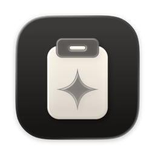
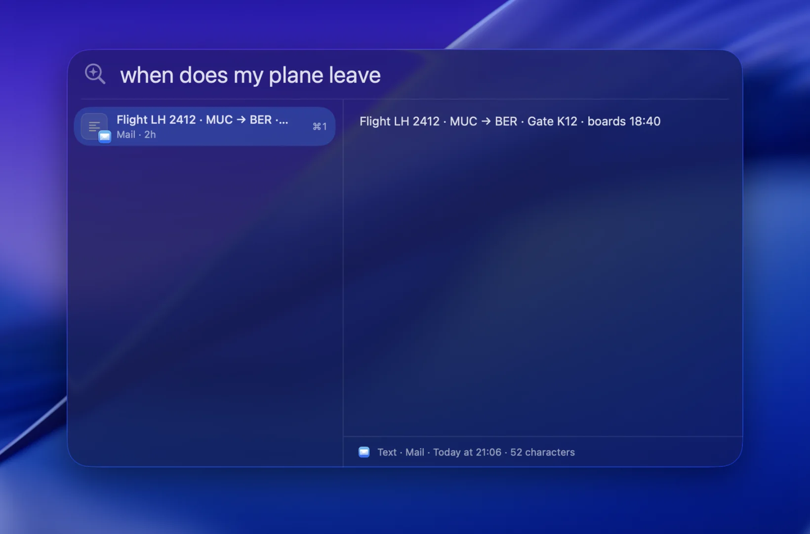
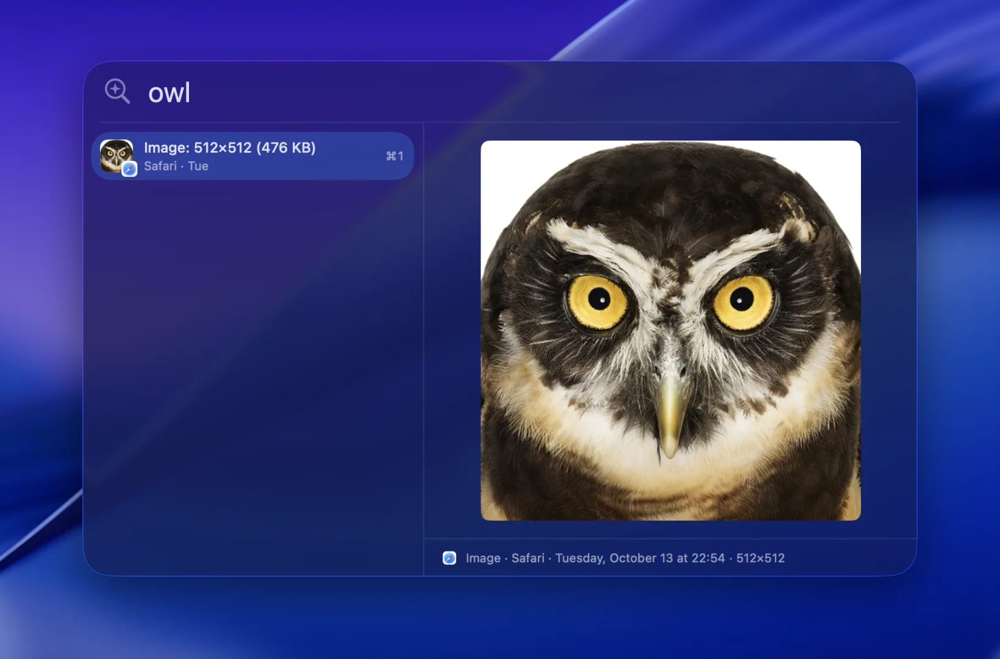
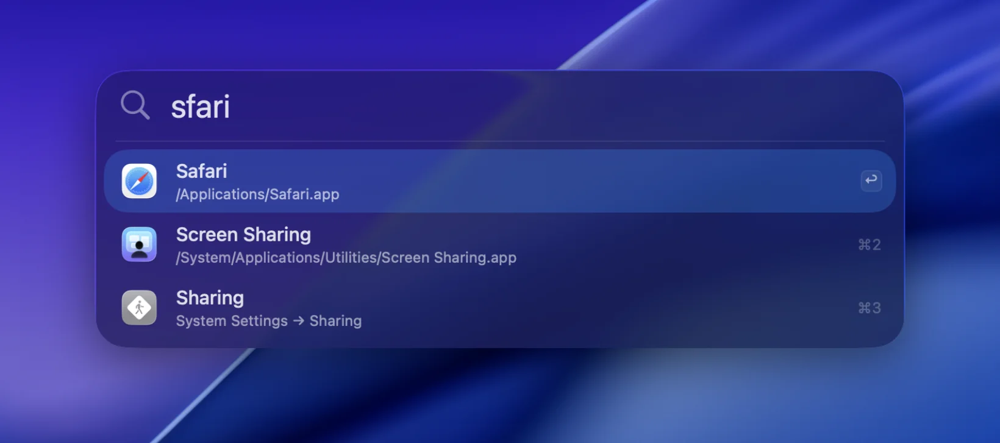

<p align="center">
  
</p>

<h1 align="center">Pastemind</h1>

<p align="center">
  <b>A clipboard with a mind.</b><br>
  Clipboard history for macOS that you search by words or by what the clip is about,<br>
  plus a search for apps, System Settings and files. It all runs on your Mac.
</p>

<p align="center">
  <a href="https://github.com/mbezruchko/Pastemind/releases/latest/download/Pastemind.dmg"></a>
</p>

<p align="center">
  <a href="https://github.com/mbezruchko/Pastemind/releases/latest"></a>
  
  
  <a href="LICENSE"></a>
</p>

<p align="center">
  <a href="https://pastemind.pages.dev">Website</a> ·
  <a href="#install">Install</a> ·
  <a href="#shortcuts">Shortcuts</a> ·
  <a href="#privacy">Privacy</a> ·
  <a href="#how-it-works">How it works</a> ·
  <a href="#build">Build</a>
</p>

https://github.com/user-attachments/assets/1b9fbfdc-edc6-4353-8dbf-c019b9bc793c

<table>
  <tr>
    <td width="33%" align="center" valign="top"><br><sub><b>By meaning.</b> "when does my plane leave" finds the flight, no word in common.</sub></td>
    <td width="33%" align="center" valign="top"><br><sub><b>Pictures by what's in them.</b> "owl" finds the photo.</sub></td>
    <td width="33%" align="center" valign="top"><br><sub><b>Search.</b> Apps, System Settings and files, typos and all.</sub></td>
  </tr>
</table>

## What it does

- **Finds a clip by what it was about.** Type "router ip" or "flight to Lisbon", in any language, and the right clip
  comes up even when it shares no words with what you typed. Words match at once, the most recent first.
- **Pictures and files by what's in them.** "owl", "a receipt", "chart of revenue" find the picture; the text in it is
  read too. A copied PDF, document, photo, video or voice memo is found by its contents ("call the dentist" finds the
  recording).
- **One more search for the rest.** ⌘ Space and "saf" for Safari, "wifi" for the Wi‑Fi settings, "'report" for files.
- **Pastes the way you need.** ↩︎ pastes into the app you were in, with its formatting or as plain text; any clip drags
  out into other apps; a tap of ⇧ shows it in Quick Look.
- **Keeps copied files.** Its own copy of a copied file (an APFS clone, free while the original stays) still pastes
  after the original is moved or deleted.
- **Private.** Everything stays on this Mac, and passwords are never kept. It runs Google DeepMind's
  [EmbeddingGemma 2](https://huggingface.co/google/embeddinggemma-2) locally through
  [llama.cpp](https://github.com/ggml-org/llama.cpp).

## Install

1. [Download Pastemind.dmg](https://github.com/mbezruchko/Pastemind/releases/latest/download/Pastemind.dmg) and drag
   Pastemind to Applications. It needs an Apple Silicon Mac with macOS 14 or later.
2. Open it. It downloads its model once: 246 MB for text, then 226 MB for pictures (and 328 MB for sound, only once a
   recording is copied or opened).
3. Press **Left ⇧ ⌘ C** for the clipboard history. The first ↩︎ asks for Accessibility access, which auto-paste needs.

It updates itself: once a day it looks for a new release, and installs only one signed with its key. **Check for
Updates…** is in the menu bar icon's menu.

## Shortcuts

Both are set in **Settings…** (menu bar icon, or ⌘, in the menu): click the shortcut and press the new keys. With
**Only the left or right modifier key** checked, Left ⇧ ⌘ C fires and Right ⇧ ⌘ C still reaches the app in front (for
Chrome's inspector, say); that takes Accessibility access, which auto-paste needs anyway.

| Default | Opens |
|---|---|
| Left ⇧ ⌘ C | Clipboard history |
| ⌘ Space | Search: apps, System Settings panes, files |

**Show icon in menu bar** (Settings → General) hides the icon. Settings is then a reopen away: open Pastemind again
from Applications, Spotlight or its own search, or press ⌘, in either panel. Settings has a **Quit Pastemind** button too.

It's one panel with two modes. Press the clipboard shortcut while search is open and the history appears under the
same field, with what you typed carried over (and the other way round); press the same shortcut again to close it.

⌘ Space belongs to Spotlight until you turn Spotlight's shortcut off (System Settings → Keyboard → Keyboard Shortcuts →
Spotlight), or pick another shortcut for search in Settings.

### In the clipboard history

| Key | What it does |
|---|---|
| ↓ ↑, ⌘↓ ⌘↑ | Moves through the clips |
| ↩︎ | Pastes into the app you were in (keeps formatting when the clip has it) |
| ⇧↩︎ | Pastes as plain text |
| ⌘↩︎ | Copies without pasting |
| ⌘1…⌘9 | Pastes that row |
| ⌘P | Pins or unpins (pinned clips stay at the top and never expire) |
| ⇧ (a tap), ⌘Y | Quick Look of a picture, files, code or text (again, Space or Esc closes it) |
| ← → | In Quick Look of several copied files: the previous or next one |
| ⌘⌫ | Deletes the clip |
| Esc | Clears the query, then closes |

Text in a picture can be copied from Quick Look: click into it, select the text (or ⌘A) and press ⌘C.

Auto-paste needs Accessibility access: the first ↩︎ asks for it (or use **Allow Auto-Paste…** in the menu bar).
Until it's granted, ↩︎ copies and you press ⌘V yourself.

The "…" button in either panel has Settings, Pause Recording and Quit.

### In search

| Key | What it does |
|---|---|
| ↩︎ | Opens the app, settings pane, file or folder |
| ⌘↩︎ | Shows it in Finder |
| ⌘C | Copies its path |
| ⇧ (a tap), ⌘Y | Quick Look of the file, folder or app (again, Space or Esc closes it) |
| ⌘1…⌘9 | Opens that row |
| ⇥ | Files only, and back (or start with `'`, a space or `open …`) |
| Esc | Closes Quick Look, then search (files only too) |

Names match by the start of the name or of a word ("store" → App Store), initials ("vsc" →
Visual Studio Code), or letters in order. What you open after typing some letters comes first for those letters next
time, and apps you use often come before ones you don't. Files come from the Spotlight index (no crawling of our own):
among apps only the few best, preferring ones you've opened, and without build output, dependencies, `~/Library` or
hidden folders. They show their Quick Look preview (a document's first page, a photo); macOS asks once for access to
folders like Downloads, since previews read the files.

## What it keeps

- **Text**, with links, colors and code recognized and shown as such. Copying the same thing again moves it to the top
  instead of adding it twice. Copying text again a little longer or shorter (it starts the same: the selection redone)
  within 5 minutes replaces the copy before (Settings → Clipboard, on by default).
- **Pictures** from a browser's "Copy Image" (its address beside it doesn't make it a link), a screenshot or any app,
  as PNG, JPEG, HEIC, WebP, GIF or TIFF (kept as PNG). Pastemind reads a copy once the app has finished writing it, so
  a big photo still being encoded isn't missed, and the history shows it at once meanwhile, as "Copying…". Pictures
  are found by what's in them ("owl", "a receipt", "chart of revenue", in any language) and by what's written in them
  (Vision reads their text); "image" finds them all.
- **A picture copied as its file** (in Finder) is an image too: shown as one ("Image: 4032×3024 (2.1 MB)", found by
  its name as well), kept to by "image:", and pasted or dragged as the file with the picture beside it.
- **Files**, found by what's in them too: a document's or PDF's text, code, a photo, a video's frames, a voice memo's
  words, a folder's contents. A long document (a PDF, Word, RTF, a web page, text or Markdown) is found by what's
  anywhere in its first ~100,000 characters, not only its start; a scanned PDF too, its text read by OCR (its first 50
  pages). For search only their vector is kept, not what was read; keys, certificates and password stores are never
  read, nor files that only live in iCloud.
- **Several files copied together** are found by any one of them (the row then names the one), and show as a grid of
  their pictures: each drags out on its own, and a click opens it in Quick Look with the others a step away.
- **Its own copy of copied files**, so one moved or deleted since still pastes, drags and shows: a clone on APFS, which
  takes no space while the original stays as it was (from another disk, a full copy). Up to 100 MB a clip (photos,
  screenshots, documents: not the videos, archives and disk images deleted to free space; Settings → Clipboard sets
  it, from off to 1 GB), never keys, certificates, password stores or files that only live in iCloud. It lasts as long
  as its clip; Settings shows what the copies of deleted files take, and removes them.

A clip drags out of its row or the preview into other apps, as a paste would give it; a picture as a file named after
its size ("Image 1400×820.png"), which upload fields and chats take, with the picture beside it. Pasted, a picture
brings its file along too: ⌘V in Finder makes that file. Unpinned clips go after 90 days or past 10,000 clips
(Settings → Clipboard, or `historyDays`, `maxClips`).

## Privacy

Everything stays on this Mac, in `~/Library/Application Support/Pastemind`. Pastemind goes online only to download the
model, once, and to look for a new version once a day, from this repository's releases (the request carries only
Pastemind's version; Settings → General turns it off).

It never keeps what apps mark as concealed or transient (passwords from 1Password and the like, per
[nspasteboard.org](http://nspasteboard.org)), or anything copied in a password manager (add more with
`defaults write app.pastemind.Pastemind ignoredApps -array com.example.app`). **Pause Recording** in the menu stops it
entirely.

## How it works

**Search:** apps (from /Applications, /System/Applications, ~/Applications and the like) and System Settings panes
(read from the system's settings extensions, localized, opened through `x-apple.systempreferences:`) are matched in
memory, ~2 ms a keystroke. Files come from Spotlight on a background queue, ~100–200 ms later, and join the list.
Opening the panel takes ~10 ms.

**Clipboard:**

```
copy ─► ClipboardWatcher (reads changeCount 4×/s) ─► SQLite (pastemind.sqlite) + in-memory ClipIndex
                                                  └► EmbeddingEngine: EmbeddingGemma 2, a vector per clip
keystroke ─► words: one memchr scan over all clips' folded text          ~0.5 ms / 10k clips
          └► meaning: query vector (~20 ms) ─► one matrix-vector product  ~1 ms / 10k clips
              └► meaning matches under the word ones, shown ~50 ms after the keystroke
```

- Motion runs at the display's rate (120 Hz on ProMotion): the window's edge moves on its `CADisplayLink`, one step
  per refresh along a Bézier curve, while the body fades in on its own Core Animation layer, off the main thread.
  Every switch was measured at 8.3 ms a frame (`motion:` lines in a debug run's log).
- The glass is Apple's Liquid Glass (`NSGlassEffectView`, regular style), tinted a little darker.
- The panel is a non-activating `NSPanel` (like Spotlight's): the app you were in stays in front, so a paste
  lands there with no focus juggling. It's built and drawn once at launch; opening it takes ~15 ms.
- Word matches show on every keystroke at once. The query is embedded at the same time, and the hybrid results
  replace them 50 ms after the keystroke, so the list doesn't reshuffle while you type.
- Ranking: what has the query in it first, the most recent first, as the history lists it ("http" puts the link
  copied a minute ago first); then the app's name or every word apart, also by recency; then what's only close in
  meaning, by cosine + a little recency. EmbeddingGemma 2 gives unrelated clips ~0.6–0.7 and good
  matches ~0.7–0.87, so a meaning match has to be within 0.1 of the best one to show, and within 0.045 to show at
  full strength (`ClipIndex.Tuning`, calibrated with `pastemind-cli eval`).

<details>
<summary><b>Meaning matches and the typical query</b></summary>

- A short clip (a word, "thanks", a chat line) comes close to any short query, whatever it asks. So a meaning match
  must also be at least 0.05 closer to the query than to the typical query (the mean of 40 everyday queries in several
  languages, made once after the model loads; for a query of one word, of 40 single words, and 0.06), and that
  closeness counts half against it in the ranking. Among 60 such clips the 24 evaluation queries all still find their
  answer and none of 26 with no answer shows anything; of 15 one-word queries 8 find theirs first (4 before) and none
  of 15 with no answer shows anything (7 did) (`pastemind-cli crowd`, `lift`, `words`).

</details>

<details>
<summary><b>The model</b></summary>

- The model is ours on Hugging Face ([mbezruchko/embeddinggemma-2-pastemind-GGUF](https://huggingface.co/mbezruchko/embeddinggemma-2-pastemind-GGUF),
  pinned to a revision, checked by SHA-256): the text model in Q6_K (Q8_0's quality in every evaluation here, vectors
  within cosine 0.997 of it, 64 MB less), and the image and audio encoders split into two files
  (`scripts/split-mmproj.py`, byte for byte), so the 328 MB audio encoder comes only when it's needed. Installs that
  have ggml-org's Q8_0 files keep them. `pastemind-cli agree` compares two text models' vectors and speed.
- The model is in memory only while it's wanted: it loads as the clipboard history opens (~0.5 s,
  done before a query has its three letters) and goes once the history has gone unused for 5 minutes. Loaded, the
  app takes ~195 MB of footprint plus the model file mapped (~280 MB); out, ~35 MB at launch, ~125 MB once it has
  been in (what llama.cpp freed stays with malloc until macOS asks for it). 0.2% CPU idle either way.
- Clips copied while the model is out wait for it (words find them at once): until the history opens next, or 32 of
  them pile up, when it loads, reads them and goes again. Queries always go before clip embedding, which runs in small
  batches behind them.
- GPU (Metal) by default, CPU as the fallback. Every Apple Silicon Mac, MacBook Air included, has a Metal GPU.

</details>

<details>
<summary><b>Pictures</b></summary>

- Pictures go through EmbeddingGemma 2's own image encoder (`mmproj-embeddinggemma-2-vision-Q8_0.gguf`, downloaded
  after the text model) into the same vector space as text, so a text query, in any language, finds them; with the text Vision
  read in them in the same input when there's 40 characters of it or more (a photo's stray letters only blur it).
  140 soft tokens a picture: ~0.2 s each on the GPU, as good as 280 at half the time (`pastemind-cli images`: 45/46
  top-1 over 50 pictures, the queries in several languages). The encoder loads in ~0.1 s, only while there are pictures to
  read (~200 MB more, gone after); the audio encoder (its own file) likewise, only while there's sound to hear.
  Until it's downloaded, pictures go by their text, and are read again once it's there.

</details>

<details>
<summary><b>Finding files by what's in them</b></summary>

- Search finds files by what's in them too (`FileIndexer`), once it's turned on: search offers it at the end of a
  query that found nothing by name (never selected unasked), or Settings → Search. Turning it on asks macOS for the
  Desktop, Documents and Downloads together, once (the rest of the home folder needs no asking). Three tiers, in the
  model's queue behind queries and clips:
  - just opened or saved, or new anywhere in the home folder (of the kinds the whole-home look below reads, and not
    where it doesn't look): read at once, about two seconds after it appears (a live Spotlight query sees it, or the
    last-used date move; at launch, its first results bring what changed in the last ten minutes), the model staying a
    minute for the next (20 s with 8 GB); past ten at once (an archive unpacked), they're read with the recent files,
    and kept till the next whole-home look has them. Quick Look's previews move no date, so they aren't seen;
  - changed in the last 60 days on the Desktop, in Downloads and Documents, or opened then anywhere in the home folder
    (`RecentFiles.find`, looked for as files change, as search opens and every ten minutes): a file every two seconds
    while you work or on battery (a tenth of the GPU);
  - the rest of the home folder worth reading (`RecentFiles.everything`, a few seconds of Spotlight every six hours,
    the first a minute after launch): only while the Mac has sat idle a minute on power. Pictures, videos, sound,
    PDFs and documents; not ~/Library, apps and packages, hidden folders, code projects and build output (unless
    opened), folders that look like datasets (200 or more of a kind side by side), SVGs or loose code and data. Here:
    218,000 files found, 9,700 kept.
  Nothing's read in Low Power Mode, with the Mac hot, on battery under 20%, or paused from the menu (which shows how far
  the reading is). Only vectors are kept (the store's `files` table), their first 256 numbers in memory (~10 MB for
  10,000 files). Search asks the model only when files are asked for (⇥, a leading ') or nothing matched well by
  name, so launching an app never loads it; those matches go under good name matches, marked "By content". They pass
  the history's bars against the typical query too (at 256 numbers): on the test files the answer came first 29 of 32
  times (27 before) and 10 of 12 for one-word queries (7), and photos that only came close to anything stopped showing
  (`pastemind-cli filecrowd`, `filedropped`).

</details>

<details>
<summary><b>Copied files, long documents and scans</b></summary>

- Copied files (`CopiedFileReader`, read off the main thread as they're copied) go in as one input under their names:
  text from documents (txt, Markdown, code, RTF, Word, OpenDocument, HTML) and PDFs (a scan's by OCR, below; one with
  none OCR reads either, a photo, by its first page's picture), pictures (an image file, three frames of a video, any other document's Quick Look preview, four at most)
  and an audio file's first 30 s through the model's audio encoder (loaded alone, ~330 MB while it's in). A text file
  embeds in ~25 ms, a picture ~0.2 s, a video ~0.6 s, a recording 0.1–0.4 s. `pastemind-cli files`: 30/32 queries
  find the right file first by contents, 13/32 by names alone (queries in several languages, 18 files of every kind).
- Several copied files get a vector each too (the first 12, `CopiedFiles.maxParts`), read one at a time after the
  vector of them all; a query waiting is answered between two. One vector of five photos, a receipt and a video blurs
  each: `pastemind-cli groups` (the 18 files copied as three clips) finds the right clip first for 6 of 32 queries by
  that vector alone, 26 with each file's too, and shows it for 30.
- A long document's text past its start goes in pieces (`CopiedFiles.pieces`: 1,200 characters, overlapping by 200,
  split at spaces, up to 100 of them: 40–60 pages), a vector each; it's as close to a query as its closest piece. PDFs,
  Word, RTF, OpenDocument, web pages, text and Markdown; not code, data or logs. Copied, its pieces follow its own
  vector; in search's files, it's found by its start at once while its pieces follow, all of them while the Mac is
  idle, four a turn every two seconds otherwise. A piece takes ~55 ms; in the store, pieces are kept at 256 numbers
  (512 bytes each). `pastemind-cli pieces` (six long PDFs, man pages and a lease, 29 queries about what's past
  their start): the right one first 8 times without pieces, 26 with (among 3,582 real files' vectors: 6 and 21, shown
  9 and 28); no-answer queries showing one 2 and 3 of 26.
- Text in scans (a PDF with less than 40 characters of text in its first five pages) and copied pictures is read by
  Vision's accurate recognizer (the fast one reads fewer languages) in `pastemind-ocr`, a process of its own beside
  the app: Vision keeps its models (~250 MB) as long as the process that used them lives, and the helper's go as it
  exits. A page takes ~1 s of one core at 200 dpi (a screenshot ~0.3 s, plus ~0.4 s to start); while you work (not
  idle on power) at background priority, on a low-power core, about five times slower. A scan's own vector reads its
  first pages, its pieces the rest (up to 50 pages, from where those stopped). Vision drops lines set too close
  together (it takes a few for one): where there's ink none of its lines cover, the page set straight by the lines'
  slant, those lines are cut apart and read again spaced out (a cramped test page: 94% of its text read before, 99%
  after; askew by 0.5–2°, 96–99%; ordinary pages ~99.5% and no second reading). Two cramped, askew, noisy scans
  (a vacancy and the lease) among the six long PDFs: 13 queries about them, the right one first for all 13
  (12 among 7,126 real files' vectors); before, by the first page's picture, a query about the vacancy's tech stack found nothing. Scans read
  before by their picture (a PDF without pieces, `CopiedFiles.readAgain`) are read again, once.

</details>

Measured on an M1 Pro (2026-10-13):

| | GPU | CPU only |
|---|---|---|
| Query embedding (in the app) | 20–45 ms | 40–65 ms |
| A 1,300-character clip (background) | ~110 ms | ~200 ms |
| A picture, 140 soft tokens (background, 2026-10-15) | 0.18–0.25 s | not measured |
| Search, 10,000 clips | 0.8 ms | not measured |
| `pastemind-cli eval` (24 queries, several languages) | 24/24 top-1 | 24/24 top-1 |

## Build

Needs an Apple Silicon Mac with macOS 14+, Xcode (not just the Command Line Tools) and CMake (`brew install cmake`).

```sh
scripts/build-llama.sh   # llama.cpp at a pinned tag, with mtmd and two small patches (~1 min)
swift test               # PastemindKit's tests
./build.sh               # → build.noindex/Pastemind.app
scripts/install.sh       # → /Applications/Pastemind.app, started (replaces the old copy safely)
```

`build.sh` signs with your "Apple Development" identity when there is one (or the one in `.sign-id`), so
the Accessibility grant survives rebuilds. The first launch downloads the model: the text model, then the image
encoder; the audio encoder comes once a recording is copied or opened.

A build of your own isn't notarized: copied to another Mac, Gatekeeper quarantines it
(`xattr -dr com.apple.quarantine /Applications/Pastemind.app` lets it open). Releases are (below).
Don't `cp -R` a new build over an installed one: the binary is rewritten in place and macOS kills it at launch for an
invalid code signature (`open` reports error -609). `scripts/install.sh` removes the old copy first.

<details>
<summary><b>Release</b></summary>

`scripts/release.sh` makes `release/<version>/`: Pastemind.app signed with a Developer ID, notarized and stapled, in a
DMG that's signed, notarized and stapled too, and the `appcast.xml` Sparkle reads (one item, signed with the update
key). Raise `CFBundleShortVersionString` and `CFBundleVersion` in `Resources/Info.plist` first; it ends with the
`gh release create` that publishes both files. The DMG's window (light paper, the icons' places, the marker under
Applications, no bars) is `scripts/dmg`: dmgbuild writes Finder's settings into the image itself, no Finder scripting
(installed into `.build/dmgbuild` on first use). To redraw the background, `scripts/dmg/background.py` with Pillow,
NumPy and fontTools in that environment (`.build/dmgbuild/bin/pip install pillow numpy fonttools brotli`). `--dry-run`, with a throwaway key in `SPARKLE_KEY_FILE`, checks the DMG
and the appcast without a Developer ID.

Once per Mac, as the top of the script says: a "Developer ID Application" certificate, notarytool's credentials under
the profile `pastemind-notary`, and the update key in the keychain under the account `pastemind` (`generate_keys`, in
Sparkle's package at `.build/artifacts/sparkle/Sparkle/bin`). Keep a copy of that key: installed copies take only
updates signed with it.

Updates are Sparkle 2's (`Updater.swift`): once a day it reads `SUFeedURL`, the latest release's `appcast.xml`, and
installs an update only if its EdDSA signature matches `SUPublicEDKey` (both in `Resources/Info.plist`). **Check for
Updates…** is in the menu bar icon's menu; Settings → General has the daily check's switch. Debug runs never check.

</details>

<details>
<summary><b>Developing</b></summary>

```sh
.build/release/pastemind-cli bench          # load time, query and clip embedding, search over 10k clips
.build/release/pastemind-cli eval           # ranking on a small clipboard corpus, with cosines
.build/release/pastemind-cli search "…"     # against your real history
.build/release/pastemind-cli crowd          # the corpus among short clips: answered and unanswered, per setting
.build/release/pastemind-cli compare "…" …  # your real history, the old ranking against the new (numbers only)
.build/release/pastemind-cli launch "…"     # the search panel's ranking, with timings
PASTEMIND_CPU=1 .build/release/pastemind-cli bench   # the same on the CPU only
```

`PASTEMIND_DEBUG=1 PASTEMIND_HOME=/tmp/pastemind PASTEMIND_PASTEBOARD=app.pastemind.test build.noindex/Pastemind.app/Contents/MacOS/Pastemind` runs a copy
with its own history on a private pasteboard that never presses ⌘V. Drive it with `scripts/pastemindctl.swift`
(`swiftc -O scripts/pastemindctl.swift -o .build/pastemindctl`): `pastemindctl copy "text"`, `show`, `query "…"`, `down`, `paste`,
`dump`, `snapshot /tmp/panel.png`, `read`; `search`, `squery "…"`, `sdump`, `ssnapshot …` for search; `settings`.

</details>

## Credits

EmbeddingGemma 2 (Apache 2.0), llama.cpp (MIT), Sparkle (MIT), highlight.js (BSD 3-Clause); third-party notices are
in `Resources/Acknowledgements.txt`, shipped with the app.

## License

MIT: see [LICENSE](LICENSE).
